  

    

  <h2>Electronics & Computer Engineering Student</h2>

  

    Embedded Systems &nbsp; · &nbsp; Firmware Development &nbsp; · &nbsp; PCB Design
  

  

---

## About Me

I'm an Electronics & Computer Engineering student with an interest in the intersection of hardware and software.

My interests include embedded systems, microcontroller programming, firmware development, and PCB design. I'm currently exploring these areas through C programming, Arduino, STM32, ESP32, and electronic design tools.

## Technical Interests

| Embedded Systems | Hardware Design |
|:---:|:---:|
| Arduino (AVR) | Altium Designer |
| STM32 | Multisim |
| ESP32 | Oscilloscope |

## Programming Languages

## Projects & Work

**Circuit Sathi**

An electronics-focused project.

[Explore Repository →](https://github.com/Hitman-886/-Circuit-Sathi-)

 

**More from my GitHub**

[Browse all repositories →](https://github.com/Hitman-886?tab=repositories)

---

## Opportunities

Currently open to internship opportunities in:

- Embedded Systems
- Firmware Development
- Electronics Engineering

---

  

Thanks for visiting my profile.

